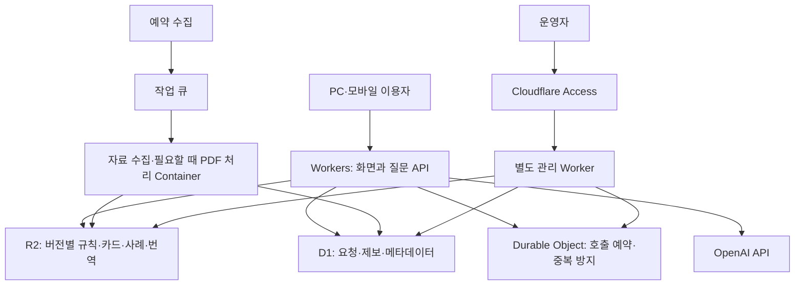

# 집 PC 없이 운영하는 Cloudflare 이전 설계

2026-10-20 확인. 구축·가입·결제·배포 미실행.

## 1. 선택안

Cloudflare는 현재 사용하는 Tunnel 외에도 앱 실행용 Workers, 파일 저장용 R2, 데이터베이스 D1, Containers를 제공한다. Tunnel은 집 PC의 서버를 연결하므로 PC를 끄면 종료된다. **앱 실행과 데이터 저장까지 Cloudflare로 옮겨야 PC를 꺼도 운영된다.**

| 방식 | PC 종료 후 | 리프트어시 적합성 |
|---|---|---|
| 현재 Quick Tunnel | 중단 | 당장 베타 유지 |
| 정적 화면만 호스팅 | 화면만 가능 | 질문 API·제보·갱신 기능은 별도 서버가 필요 |
| Workers + D1 + R2 | 가능 | 장기 권장. 기존 저장·실행부를 변경해야 함 |
| Node Container 상시 실행 | 가능 | 기존 실행 환경에 가깝지만 저장소 분리 필수, 상시 자원 비용 증가 |

Workers Free는 하루10만 요청, 호출당 CPU10ms 제한이 있다. 현재 매 질문마다 전체 규칙의 빈도 통계를 재계산하는 검색과 PDF 처리를 그대로 올려 무료 안정 운영을 보장할 수 없다. **Paid 월 $5 기본요금을 기준으로 준비**하고, 검색을 미리 색인해 비용을 줄인다. 순수 정적 자산 요청은 별도 무료 범위가 있다. [Workers 요금](https://developers.cloudflare.com/workers/platform/pricing/), [실행 제한](https://developers.cloudflare.com/workers/platform/limits/)

## 2. 권장 구성

일반 이용자는 현재처럼 로그인 없이 질문한다. 관리자만 본인 계정으로 인증한다. 공개 앱에는 관리 API와 비밀 저장소를 노출하지 않는다.

### 구성별 역할

- **public Worker**: 정적 UI, `/api/ask`, `/api/cards/search`, 카드 상세, `/api/sources/translate`, `/api/reports`. OpenAI 키는 서버 Secret으로만 사용한다.
- **D1**: 기존 requests/calls/reports/report_history/settings 대응 테이블, 자료 버전·수집 상태·검색 메타데이터. 비용은 읽은 행/쓴 행/저장량 기준이므로 검색은 전체 스캔 대신 색인 조회로 바꾼다. [D1 요금](https://developers.cloudflare.com/d1/platform/pricing/)
- **R2 Standard**: 불변 자료 묶음, 원문 PDF/HTML 보관본, 번역 캐시, 암호화 백업. 공개 자료용과 비공개 백업용 버킷을 분리하고 기본 공개 접근을 끈다. 무료 포함량은 저장10GB-month, Class A100만/월, Class B1,000만/월이며 초과 요금이 있다. [R2 요금](https://developers.cloudflare.com/r2/pricing/)
- **전역 조정 객체**: 일별/월별 API 비용 예약, 동시 생성3개, 익명 세션별 한도, 만료 가능한 작업 잠금. 즉시 일관성이 필요한 한도를 캐시나 프로세스 메모리만으로 세지 않는다.
- **예약 작업/큐**: 자료 확인과 일별 보존 정리. 예약 호출은 UTC이므로 한국 시간 표시와 실행시간을 분리한다. [Cron Triggers](https://developers.cloudflare.com/workers/configuration/cron-triggers/)
- **짧게 실행하는 Node Container**: PDF 추출·큰 최초 색인만 수행하고 종료한다. 네트워크 접근 차단을 우회하는 용도가 아니다. Containers의 기본 디스크는 임시 저장소이므로 운영 SQLite를 여기에 두지 않는다. [저장 특성](https://developers.cloudflare.com/containers/faq/)
- **관리 Worker**: Access로 운영자 이메일을 제한한다. 현재 공식 지원인 `ctx.access`에서 인증된 신원을 확인하고, 인증 컨텍스트가 없으면 거절한다. 클라이언트가 보낸 이메일 헤더만 믿지 않는다. 별도 경로에서 JWT를 직접 받을 경우 서명·audience·issuer·만료를 검증한다. [Access 연동](https://developers.cloudflare.com/workers/configuration/cloudflare-access/)

관리 화면의 버튼은 ‘AI 질문 접수 켜기/끄기’, ‘자료 갱신’, ‘버전 되돌리기’, ‘제보’, ‘사용량’으로 바뀐다. 클라우드에서의 끄기는 새 유료 요청 접수를 막는 것이며 호스팅 요금제 해지와 다르다. 진행 중 요청은 마무리하고 관리자·제보·자료 안내는 접근 가능하게 둔다.

## 3. 현재 코드의 이식 범위

| 현재 | 변경 후 |
|---|---|
| Node HTTP 서버/로컬 포트 | Worker fetch 핸들러, 공통 질문 처리 함수 |
| `node:sqlite`, 동기 트랜잭션 | 비동기 OperationsStore 인터페이스 + D1 어댑터 |
| `.env`, `private/storage.key` | Worker Secrets, 암호화 키 버전 관리 |
| fs 규칙/카드/번역 읽기 | KnowledgeProvider/R2 어댑터 |
| 프로세스 전역 검색 배열 | 미리 만든 검색 색인 + 버전별 캐시 |
| 로컬 관리자 파일 토큰 | Access 인증과 서버의 관리자 권한 확인 |
| child_process로 서버 켜기 | 서비스 상태 플래그, 배포 버전 선택 |
| 로컬 주기적 정리 | 예약 작업으로 7/30/90일 정리 |

Workers는 Node API 호환을 제공하지만 로컬 PC의 영속 디스크와 동일하지 않다. `.env`와 SQLite 파일을 그대로 업로드하는 배포는 하지 않는다. [Node 호환성](https://developers.cloudflare.com/workers/runtime-apis/nodejs/), [Secrets](https://developers.cloudflare.com/workers/configuration/secrets/)

질문 처리·검색·근거 조립·OpenAI 호출·후처리를 HTTP/파일/DB 코드에서 분리해 로컬과 클라우드가 공유한다. 인터페이스는 `readSnapshot`, `beginQuestion`, `reserveCall`, `finishCall`, `completeQuestion`, `createReport`, `purgeExpired`를 기준으로 만든다. D1에 Node식 `BEGIN` 콜백을 그대로 옮기지 않고 원자적 배치와 전역 예약 흐름에 맞게 다시 작성한다.

### 비용 예약과 중복 처리

`clientKey → pending 예약 → 모델 호출 → 토큰 정산 → 완료 결과` 순서. 두 화면/재전송/배포 전환이 동일 키를 보내도 추가 호출하지 않는다. 공급자 응답을 받았는지 불분명한 중단은 자동 재호출하지 않고 상태를 남긴다. 예약 만료 처리와 실제 과금 누락을 구분한다. 비용 상한의 남은 예산보다 입력 추정+최대 출력 비용이 크면 접수를 막는다.

### 검색과 자료 버전

코어/대회 기본 검색은 빌드 시 만든 역색인/문서 빈도를 사용한다. 모든 질문마다 전체11,000여 Q&A 본문을 메모리에 올리지 않는다. 후보 ID와 조건 정보를 조회한 후 필요한 본문만 R2에서 읽는다. Workers isolate 메모리128MB 범위에서 색인을 나눠 캐시하고 실제 CPU 사용을 측정한 뒤 운영 크기를 결정한다. 임베딩은 초기 필수 의존성으로 넣지 않는다. [메모리 제한](https://developers.cloudflare.com/workers/platform/limits/)

활성 자료 포인터는 전역 조정 계층에서 일관되게 읽어 요청에 고정한다. R2 업로드가 모두 성공하고 해시 확인을 마친 묶음만 활성화한다. 클라우드의 여러 인스턴스에서 각각 최신 포인터를 추정하지 않는다. 과거 답변의 상세 열기는 과거 sourceHash를 사용한다.

## 4. PC 독립적인 수집 작업

예약 → 출처 버전 확인 → 변경 작업을 큐에 등록 → 수집/파싱 → R2 업로드 → 검증 → 활성 포인터 변경. 작업은 재실행해도 중복 적용되지 않고 실패 지점부터 재개한다. 공식 자료용과 커뮤니티 자료용 큐/상한을 구분한다.

기본 Container의 예시가 1GiB 메모리·0.25vCPU·4GB 디스크이고 하루30분씩 한 달30일만 실행된다면, 메모리15GiB-hours·CPU 상한225vCPU-minutes·디스크60GB-hours다. 현재 Paid 포함량25GiB-hours/375vCPU-minutes/200GB-hours 이내의 산술 예시다. 실제 최초 수집·다른 Container·부가서비스 사용량이 합산되므로 추가요금0을 보장하지 않는다. [Containers 요금](https://developers.cloudflare.com/containers/platform/pricing/)

리프트나루 자동 제공 경로가 없다면 클라우드로 옮겨도 그 문제는 그대로 남는다. 기존 정상 카드 DB로 서비스를 유지하고 관리자가 파일을 가져오는 방식이 대체 경로다. 이때 PC가 꺼져도 질의응답은 가능하지만 새 카드의 무인 수집은 가능하다고 표시하지 않는다.

## 5. 이전 순서

1. **별도 실행부 작성**: 통합본 아래 `deploy/cloudflare/`를 미래 작업 위치로 사용. 현재 `.env`/데이터/로그는 복사해 배포하지 않는다.
2. **계정 연결**: 사용자가 로그인하고 Workers/D1/R2/Containers 이용 가능 여부와 결제 조건을 확인한다. 처음은 `<서비스명>.<계정명>.workers.dev` 형태의 시험 주소. 실제 사용 가능 이름은 계정에서 확인해야 한다.
3. **격리 환경 생성**: staging용 DB/버킷/Secrets와 생산용을 분리한다. 최초에는 AI 생성 차단 상태로 화면·자료·저장 기능부터 연결한다.
4. **공개 자료 이전**: 검증된 자료 묶음 업로드, 버전/개수/해시 확인. 사용 허가가 필요한 공급원은 확인 범위만 옮긴다.
5. **개인 기록 이전**: 보존 기간이 남은 요청/제보만 처리. 로컬에서 읽고 별도 클라우드 키로 재암호화하며 평문 파일을 남기지 않는다. 키 버전을 함께 저장하고 복구 절차를 둔다. 사진은 계속 저장하지 않는다.
6. **기능 확인**: 관리자 차단, 익명 소유권, 제보 재현 정보, 중복·동시한도, 자료 교체, 갱신 실패 복구, PC 연결 없이 응답. 유료 질문은 범위가 허가된 경우에만 제한적으로 한다.
7. **최초 전환**: 기존 서버의 새 요청/제보 쓰기를 짧게 막고 진행 중 작업을 마친 뒤 최종 DB 변경분을 이전한다. 새 URL로 안내하고 두 곳을 동시에 주 운영 DB로 쓰지 않는다. 현재 임시 터널 주소를 그대로 가져오는 전환은 아니다.
8. **나중에 개인 도메인 연결**: 도메인 구매 후 Worker에 연결. 정식 주소 변경 안내와 검색 등록. 구매 가능 여부·가격은 그때 확인한다.

Cloudflare에서 기능 확인을 마치기 전 집 서버를 종료하지 않는다. 이전 후 PC가 꺼져도 사용자 요청·자료 스케줄·제보 저장이 Cloudflare만으로 동작해야 완료다.

## 6. 이후 패치·되돌리기

Workers는 버전 업로드와 실제 트래픽 배포를 분리하고 두 버전으로 트래픽을 나눌 수 있다. 시험 버전 확인 → 소량 전환 → 전체 전환 순서로 사용한다. [버전과 배포](https://developers.cloudflare.com/workers/versions-and-deployments/)

이 기능만으로 DB 스키마·사용자 세션·작업 큐·진행 중 요청의 호환성이 해결되지는 않는다. API 응답 계약과 공용 데이터 스키마를 양 버전이 읽도록 유지하고, destructive migration은 별도 점검 시간을 둔다. 기존 질문을 강제 새로고침하지 않는다. 코드 버전 되돌리기와 자료 버전 되돌리기 버튼은 분리한다.

클라우드 이전 후 쓰인 제보를 잃을 수 있으므로 오류 때 단순히 옛 집 DB로 돌아가지 않는다. 우선 클라우드의 직전 코드/자료 버전으로 복구하고, 집 PC 복귀가 필요하면 쓰기 중단·최종 데이터 재이전 절차를 따른다.

## 7. 완료 조건과 남은 의존성

완료 조건: PC 종료 상태에서 외부 질의/제보/자료 갱신 가능, 관리자만 운영 접근, 서버 Secret 노출0, 데이터 손실 없는 복구 확인, 비용·실패 알림 작동. **이번에는 확인하지 않았다.**

외부 의존성: Cloudflare 계정/기능 활성화/본인 결제, 새 공개 주소 선택, 자료 공급 조건, 승인된 품질 문항. 설계 준비는 완료했으나 이식 코드는 미작성이다. ‘명령하면 즉시 배포 완료’가 아니라 ‘명령하면 이 순서로 구현·연결을 바로 시작 가능’한 상태다.
